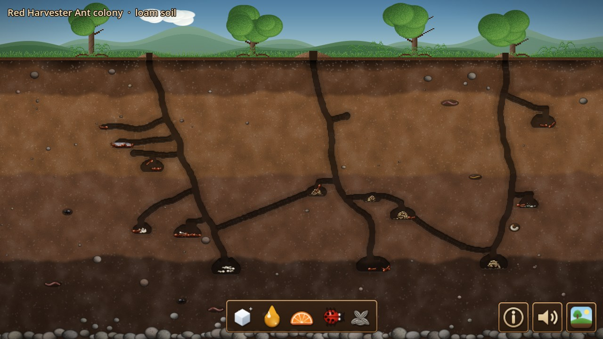
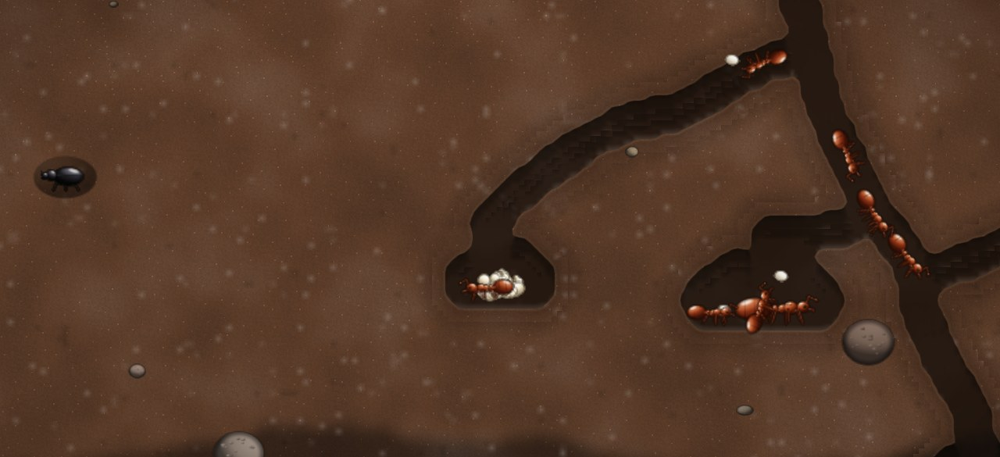
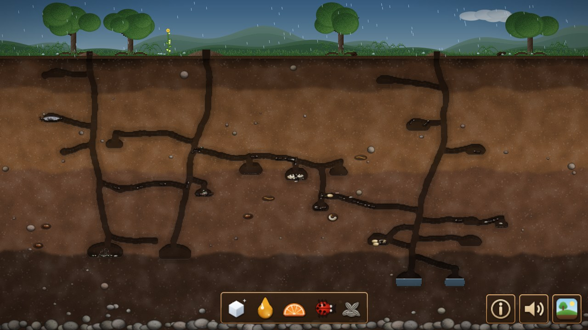
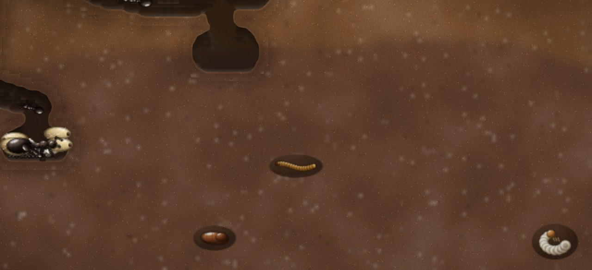

# SimAntics

A passive, observational ant-farm simulation for Android, built in Godot 4.7.2 (GDScript, Compatibility renderer, 1280x720 landscape). There is nothing to win or lose: you watch a self-sustaining colony live.

**Download:** the latest APK is on the [Releases page](https://github.com/SeanShaffer88/SimAntics/releases/latest).



| | |
|---|---|
|  |  |
| Zoomed in: workers on the walls and brood in the chambers | A long downpour floods the deepest chambers |
|  | |
| Grubs, pupae and wireworms in the soil, waiting to be dug into | |

## What's in it

- **Every player's colony is unique.** A seed created on first launch picks the species (Red Harvester, Big-headed, Leafcutter, Pavement or Black Garden Ant), the soil type and the nest blueprint.
- **A root-like nest.** Winding galleries run down from two or three mound entrances; side branches end in small rounded chambers, and galleries that meet join into loops.
- **A growing nest.** Once every planned room is dug, a colony of 15+ workers keeps extending its galleries and rooms (up to 8 times).
- **Rain.** Showers darken the topsoil, which dries over time; damp soil is quicker to dig, and foragers drink the drops left on the grass.
- **Nutrition.** Stored food is sugary (sugar, nectar, fruit), protein (ladybugs, insects) or both (seeds, leaves). Workers live on sugars; larvae only grow on protein, and the queen needs protein to lay. What you feed shapes how the colony grows.
- **Life and death.** Workers live a few times longer than they took to develop. Old foragers die out on a trip; ants that die in the nest are left until they start to smell, then carried to the refuse pile (harvesters leave them on the midden outside).
- **Temperature.** Air and soil temperature follow the season, the time of day and the weather; the daily swing fades with depth. Ants are cold-blooded: they slow in the cold and speed up in warmth. Each species forages only within its own ground-temperature range, and nurses keep the brood in whichever nursery is closest to 28°C. The info panel shows ground, upper-nest and deep temperatures.
- **Brood biology.** A founding queen raises small nanitic workers first; majors and soldiers only appear once the colony has 20+ workers and protein in store. Nurses keep eggs in a central clump with larvae around it, bigger larvae further out and pupae at the edges. When protein runs out, nurses feed some eggs to the larvae.
- **Weather defences.** Harvesters and leafcutters plug their entrances with soil and pebbles at night, in rain and in the cold, once every forager is home. In winter the colony huddles in the deepest chambers. Damp seeds sprout in the granaries and workers throw them out. Workers of one caste vary a little in size.
- **Ants on every surface.** Ants walk on gallery floors, walls and ceilings (upside down), split between both sides of a tunnel, and some rest up on chamber walls. Idle ants spread out instead of piling up.
- **Disease and social immunity.** In damp weather foragers can come home dusted with fungal spores (a green tint). Nestmates that meet them groom the spores off; one left too long falls sick and walks out of the nest to die alone, protecting the colony.
- **Life in the soil.** Scarab grubs, wireworms, moth pupae, ground beetles and earthworms live in small cells in the soil. When the diggers break into one, helpless larvae and pupae are cut up and carried to the stores as protein; beetles and worms burrow away.
- **Art.** Ants, brood and nest items are drawn at twice screen resolution from smooth, anti-aliased shapes; the soil is drawn by a shader with smooth tunnel walls and fine sand grain; the surface scenery is painted at full resolution.
- **Floods.** A long, heavy downpour runs down open entrances and floods the deepest chambers; ants carry the brood up to dry rooms, the queen moves up, and the water soaks away. Plugged entrances keep it out.
- **Founding and digging.** A new colony starts as a founding queen, her first brood and four workers in one small chamber. Workers dig the rest of the nest out over time:
  - Each soil pellet they carry out lands on a growing mound.
  - Chambers widen as they're dug.
  - New entrances break through to the surface.
  - The queen moves down into her deep chamber once it opens.
- **A living colony.**
  - The queen lays eggs, which become larvae, then pupae, then pale callow workers.
  - Nurses carry and feed the brood.
  - Workers haul waste and dig.
  - Foragers bring food home.
  - Workers change job with age, and majors and soldiers guard.
  - Mature colonies raise winged queens and males, which leave on a nuptial flight after rain.
- **Food, weather and visitors.**
  - Drag sugar, nectar, fruit, a dead ladybug or seeds onto the surface. Each food draws foragers differently, but the preferences are never shown.
  - Occasional rain sends everyone home.
  - A bird sometimes hunts surface ants. Tap it three times to scare it off.
- **Watching.**
  - Tap an ant or a chamber to inspect it.
  - Tap the same ant again to follow it: the camera zooms in and tracks it, with a live label. Tap elsewhere or drag to stop.
  - Double-tap, pinch or scroll to zoom.
  - There's a day/night cycle and scent trails.
  - The info panel shows colony stats and a population graph, and can start a new colony.
- **Saved progress.** The colony saves itself and catches up on time away (up to 8 hours).

All art and sound is generated in code. The project has no external assets.

## Running

Open the folder in Godot 4.7.2 and press F5.

Developer launch options (after `--`):

- `--colony-seed=123` previews a specific colony without touching your saved one.
- `--mature` opens the whole nest at once instead of starting from a founding queen.

## Tests

```
godot --headless --path . -s res://tools/tests/test_nest_generator.gd
```

These check 300 seeds: every chamber is reachable, no chambers overlap, every node stays inside the frame, the chamber roles are valid, and the same seed always gives the same nest.

```
godot --headless --path . -s res://tools/tests/test_inside_nest.gd -- --colony-seed=3
```

Plays a colony at 10x and fails if any ant or brood item ends up inside solid soil.

## Android

`export_presets.cfg` builds an arm64 APK. `tools/build_release.ps1` signs a release build with your own keystore; the script's header explains the one-time setup.
